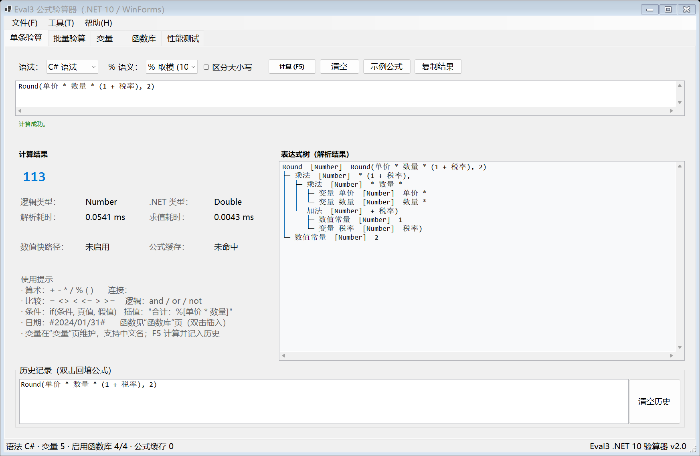
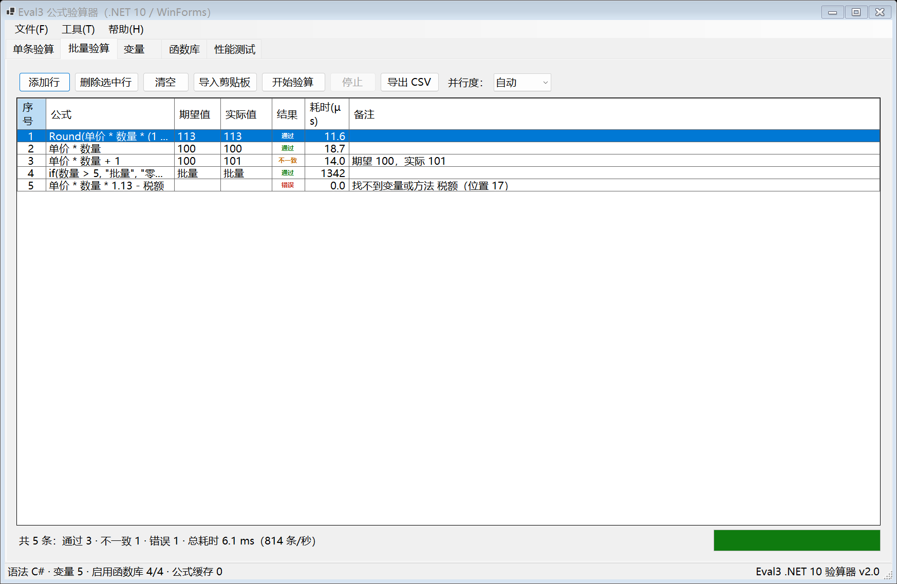
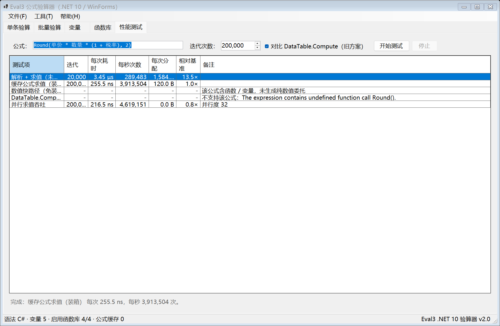

# Eval3 —— .NET 10 公式计算组件与 WinForms 验算器

把原来的 VB.NET（.NET Framework 4.8）计算组件 **Eval3** 与 C# 版 **Eval3Lib2**
统一重写为 **.NET 10 / C#** 的高性能表达式引擎，并配套一个 WinForms 验算界面。

* 计算内核：词法分析 → 递归下降语法分析 → 表达式树求值（**解析期完成类型推导与调用绑定**）
* 目标框架：`net10.0`（类库）/ `net10.0-windows`（验算器）
* 实测性能（2026-10 升级后，见 §0）：数值快路径 **1.0～5.9 ns/次、零堆分配**；文本模板 **66 ns / 168 B**；
  24 核并行吞吐 **约 11.8 亿次/秒**；比旧的 `DataTable.Compute` 方案快 **约 1 500 倍**
* 表达式树编译后端：**FastExpressionCompiler**（直接生成 IL），编译耗时约为 `Expression.Compile()` 的 **1/20 ~ 1/200**
* 水蒸汽物性库：`Eval3.Thermo`（可选工程，纯托管 IAPWS-IF97，无原生依赖）
* 单元测试：**183 个 xUnit 用例全部通过**

---

## 0. 2026-10-27 公式编译升级（当前版本）

三轮升级：**整树数值/对象编译 → 安全 CSE / 惰性编译 / LRU → 日期、模板、decimal/整数模式、解析缓存**。

| 能力 | 实现 | 效果 |
|---|---|---|
| 整树数值编译 | `Compilation/NumericPlan.cs` | 常量 18.0 → **1.0 ns**；变量 14.7 → **4.8 ns**；`Round` 18.9 → **5.9 ns** |
| 对象路径整树编译 | `Compilation/ObjectPlan.cs` | 文本模板 **104 → 66 ns**，分配 **400 → 168 B（-58%）** |
| 日期运算进整树 | `NumericPlan` / `ObjectPlan` | 日期差 **6.8 → 1.8 ns**、零分配；日期 ± 天数进入对象路径 |
| 常量折叠 / 数值 `if` | `NumericPlan` | 全常量公式 0 次 IL；`if` **48 B → 0 B** |
| 安全 CSE | `NumericPlan` + `[Pure]` | 重复子式 **33.8 → 4.7 ns**；纯函数重复 **17.6 → 3.9 ns** |
| 列式批量 | `BatchFormula` | 1M 点 **0.4～2.5 ns/点**（逐点 4～5 ns） |
| 解析缓存 | `Runtime/ExpressionCache.cs` | 同一公式重复解析 **21 ns / 0 B**（首次解析仍约 1 650 B） |
| LRU 公式缓存 | `Runtime/FormulaCache.cs` | 不再整表清空；`CacheHits / CacheMisses` |
| decimal / 整数模式 | `EvaluatorOptions.NumericMode` | 金额走 decimal（`Vat(100.00,0.13)=13.00`）；整数走 long，溢出提升 decimal |
| 运行时诊断 | `EvaluateWithDiagnostics` | 异常带 `NodeSource / Position` |
| AOT / 无 JIT | `EvaluatorOptions.EnableJit = false` | 全树遍历，无动态代码 |

实测（`dotnet run --project src\Eval3.Benchmarks -c Release -- 400000`）：

| 项目 | 旧路径 | 新路径 | 提升 |
|---|---:|---:|---:|
| 缓存公式 `EvaluateNumber`（常量） | 18.0 ns | **1.0 ns** | 18× |
| 变量公式 `EvaluateNumber` | 14.7 ns | **4.8 ns** | 3.1× |
| `Round` 函数 `EvaluateNumber` | 18.9 ns | **5.9 ns** | 3.2× |
| `Sum(1..5)` `EvaluateNumber` | 5.9 ns | **3.1 ns** | 1.9× |
| 字符串模板 `Evaluate` | 104.0 ns / 400 B | **66.0 ns / 168 B** | 1.6× / -58% 分配 |
| 24 线程 `Round` 吞吐 | 553 M/s | **1.18 B/s** | 2.1× |
| 解析 + 求值（首次，未缓存） | 699 ns / 1 648 B | 同左 | AST 节点主导，见 §4 |
| 解析（同一公式，缓存命中） | 699 ns / 1 648 B | **21 ns / 0 B** | 33× / 0 分配 |

新增/变更的公开配置：

```csharp
var options = new EvaluatorOptions
{
    UseWholeTreeNumericCompiler = true,  // 默认；false 回退旧的逐节点数值委托
    EnableJit = true,                    // 默认；false 全树遍历（NativeAOT / iOS）
    NumericMode = NumericMode.Double,    // Double / Decimal / Integer
    EnableParseCache = true,             // 编辑器重复校验同一公式时复用 AST
    MaxCacheSize = 2048,                 // LRU 容量（公式缓存与 AST 缓存共用）
};

var compiled = evaluator.Compile("Round(price * count, 2)");
object? value = compiled.EvaluateWithDiagnostics();   // 失败时带出错节点
```

> 说明：下文 §3.3 的优化清单与 §4 的实测表是升级前基线；最新数据以本节为准。> 说明：下文 §3.3 的优化清单与 §4 的实测表是升级前基线；最新数据以本节为准。

---

## 1. 目录结构

```
Eval3Lib.sln                     解决方案（5 个项目）
Directory.Build.props            公共编译设置（.NET 10 / 可空引用 / 分析器）
src/
  Eval3/                         ★ 计算组件类库（net10.0）
    Evaluator.cs                 组件入口：解析、缓存、求值、函数库注册
    EvaluatorOptions.cs          语法 / 大小写 / ％语义 / 缓存配置
    CompiledFormula.cs           已解析公式（含免装箱数值快路径）
    EvalType.cs                  逻辑类型、语法枚举、记号类型、优先级
    EvalVariable.cs              变量
    EvalExceptions.cs            ParserException / VariableNotFoundException / FormulaRuntimeException
    Interfaces.cs                IValue / ITypedValue / IHasDescription / IVariableBag / IInheritedFunctions
    Parsing/                     Tokenizer（单遍扫描）、Parser（递归下降）
    Expressions/                 表达式树节点与运算符实现
    Functions/                   反射成员解析、调用委托编译、内置函数库
    Compilation/                 表达式树编译后端（FastExpressionCompiler + 自动回退）
    Runtime/                     类型映射与值转换
    Diagnostics/                 表达式树文本化、函数库清单
    Variables/                   字典变量容器
  Eval3.WinForms/                ★ WinForms 验算界面（net10.0-windows）
  Eval3.Cli/                     命令行验算工具（eval3 "1+2*3"）
  Eval3.Benchmarks/              命令行性能对比工具
  Eval3.Thermo/                  ★ 水蒸汽物性函数库（可选，net10.0，纯托管，依赖 XSteamNET）
tests/Eval3.Tests/               xUnit 测试（163 个用例）
docs/screenshots/                界面截图
legacy/                          原始 VB / C# 源码（原样保留，便于对照）
```

> `legacy/` 中的 `Eval3Lib.vbproj`、`Eval3Lib2.csproj` 与源码保持原有相对结构，
> 只是不再参与新解决方案的编译。

---

## 2. 快速开始

```powershell
dotnet build Eval3Lib.sln -c Release          # 编译全部项目
dotnet test  tests\Eval3.Tests -c Release     # 运行 163 个单元测试

dotnet run --project src\Eval3.WinForms -c Release                  # 启动验算界面
dotnet run --project src\Eval3.Cli -c Release -- "Round(1000/3, 2)"  # 命令行验算
dotnet run --project src\Eval3.Benchmarks -c Release -- 200000       # 性能对比
dotnet run --project src\Eval3.Benchmarks -c Release -- --compiler   # 表达式树编译后端对照
```

界面支持离屏渲染截图（自动化验收用）：

```powershell
dotnet run --project src\Eval3.WinForms -c Release -- --render docs\screenshots --tab 0,1,2,3,4
```

---

## 3. 计算内核架构

```
公式文本
   │  Tokenizer          单遍扫描；数值 / 日期字面量当场解析为强类型值
   ▼
记号序列
   │  Parser             递归下降 + 优先级判定；解析期完成：
   │                     · 类型推导（Number / String / Boolean / Date / Object）
   │                     · 运算符绑定（+ - * / % & 比较 逻辑）
   │                     · 重载打分选择 + 调用委托编译
   ▼
表达式树 Expression
   │  Evaluate()         求值期：只做委托调用与拆箱，无反射、无类型判断
   ▼
结果（object?）→ ValueConvert.ConvertToString 展示
```

关键类型（对应旧版 `opCode` 家族）：

| 表达式节点 | 旧版对应 | 说明 |
| --- | --- | --- |
| `ConstantExpression` | `opCodeImmediate` | 字面量常量 |
| `BinaryExpression` | `opCodeBinary` | 算术 / 比较 / 连接运算 |
| `PercentExpression` | `opCodeBinary`（`%`） | 百分比语义 |
| `LogicalExpression` | `opCodeBinary`（and / or） | **短路**逻辑运算 |
| `NegateExpression` / `NotExpression` | `opCodeUnary` | 一元运算 |
| `ConvertExpression` | `opCodeConvert` | 逻辑类型转换 |
| `MethodCallExpression` | `opCodeCallMethod` | 方法 / 属性 / 字段 / 索引器 |
| `VariableExpression` | `opCodeGetVariable` | 变量引用 |
| `ArrayIndexExpression` | `opCodeGetArrayEntry` | 数组下标 |
| `ConditionalExpression` | —（旧版未实现） | `if(条件, 真值, 假值)` |
| `StringTemplateExpression` | —（旧版未实现） | `"合计：%[金额 * 1.13]"` |

### 性能优化清单

| # | 优化点 | 说明 |
| --- | --- | --- |
| 1 | 解析产物可复用 | 一次解析、多次求值；`Evaluator.Compile` 按公式文本缓存（并发字典） |
| 2 | 数值快路径 | 数值常量、变量与数值函数组成的公式自动编译成 `Func<double>`，**零装箱、零分配** |
| 3 | 调用委托编译 | 反射成员编译为 `(target, args) => result` 委托，替代 `MethodInfo.Invoke` |
| 4 | 参数类型转换内联 | 参数转换在编译后的委托内部完成，类型已匹配时零开销 |
| 5 | 成员解析缓存 | “类型 + 成员名 → 候选成员”缓存，重载打分只在解析期做一次 |
| 6 | 词法扫描 | 单遍扫描、`ReadOnlySpan<char>` + `double.TryParse(span)`，无 `StringBuilder` 拼装 |
| 7 | 运行时类型判断消除 | 类型推导全部前移到解析期；求值期只有委托调用 |
| 8 | 值转换热路径 | `ValueConvert.AsDouble` 对已是 `double` 的值零分支返回 |
| 9 | 参数数组租借 | 反射调用参数用 `ArrayPool<object?>` 租借，避免每次求值分配 |
| 10 | 不可变、可并发 | 表达式树不持有可变状态，可安全 `Parallel.For` 批量验算 |
| 11 | 短路与惰性 | `and` / `or` 短路，`if(...)` 分支惰性求值 |
| 12 | 缓存上限 | 公式缓存超过阈值整体清空，避免长时间运行内存膨胀 |
| 13 | 快速表达式树编译 | 成员调用委托由 **FastExpressionCompiler** 直接生成 IL，编译耗时降至 `Expression.Compile()` 的 1/20 ~ 1/200 |
| 14 | 快路径覆盖变量与函数 | 变量引用与数值函数调用同样编译为免装箱委托，业务公式（含 `Round(...)` 等）不再逐节点装箱 |

### 数值快路径（免装箱）的覆盖范围

`CompiledFormula.EvaluateNumber()` 在公式满足数值条件时走编译好的 `Func<double>`，否则自动退回逐节点求值：

| 节点 | 是否进入快路径 | 说明 |
| --- | --- | --- |
| 数值常量、`+ - * / %`、一元负号、百分比 | ✅ | 组合已有委托，无额外编译 |
| **变量引用** | ✅ | 限定数值型变量；每次调用重新读取变量当前值 |
| **数值函数 / 属性 / 字段** | ✅ | 返回值为数值类型且形参全为数值类型时，把整个调用编译成单个委托 |
| `params` 数组、可选参数 | ✅ | 数组直接按元素类型构造，可选参数用默认值补齐 |
| 日期、文本、比较、逻辑、`if(...)`、字符串插值 | ❌ | 语义不同（如「日期 - 日期」取相差天数），留在树遍历路径 |

转换规则与反射调用逐条对齐，因此快路径与树遍历结果**逐位相同**：

* 整型形参用 `Convert.ToInt32(double)` 而不是强制转换，保留 `ValueConvert.ConvertTo` 的银行家舍入与溢出行为；
* 变量实参为 `null` 时仍抛出与反射路径一致的 `InvalidCastException`，不会静默变成 `0`；
* 返回 `decimal` / `long` / `float` 等类型的成员按同样的规则换算成 `double`。

同进程对照（400,000 次迭代，取 3 轮最快值；绝对值随 CPU 频率状态波动，以倍数与分配量为准）：

| 公式 | 逐节点求值 | 数值快路径 | 加速 | 每次分配 |
| --- | ---: | ---: | ---: | ---: |
| `price * count * (1 + rate)` | 17.4 ns | **13.9 ns** | 1.3× | 48 B → **0 B** |
| `Round(price * count * (1 + rate) / 3, 2)` | 81.4 ns | **39.3 ns** | 2.1× | 144 B → **0 B** |
| `Sum(1, 2, 3, 4, 5)`（`params`） | 60.3 ns | **23.2 ns** | 2.6× | 88 B → 64 B |

`Sum` 仍保留 64 B：`params double[]` 每次调用都要构造一个数组，无法避免。

### 表达式树编译后端（FastExpressionCompiler）

反射成员调用委托由 `Eval3.Compilation.ExpressionTreeCompiler` 编译：默认走
[FastExpressionCompiler](https://github.com/dadhi/FastExpressionCompiler) 的 `CompileFast()`，
遇到它不支持的表达式节点或平台时自动回退到 `Expression.Compile()`，
两条路径的求值语义完全一致，回退不影响计算结果。

```powershell
dotnet run --project src\Eval3.Benchmarks -c Release -- --compiler        # 编译后端对照
dotnet run --project src\Eval3.Benchmarks -c Release -- 200000 --no-fast-compiler   # A/B 对照
```

实测（.NET 10.0.11 / 32 逻辑核，同进程 A/B，每项 2000 次编译）：

| 表达式树（与 `MethodInvoker` 生成结构一致） | `Expression.Compile` | FastExpressionCompiler | 编译加速 |
| --- | ---: | ---: | ---: |
| 静态方法调用（1 参） | 66.1 µs | 2.5 µs | 26× |
| 实例方法调用（2 参） | 137.3 µs | 5.2 µs | 26× |
| 实例属性读取 | 43.1 µs | 2.3 µs | 19× |
| 可选参数默认值（1 参） | 2.45 ms | 8.8 µs | 278× |
| params 数组（3 参） | 251.4 µs | 4.6 µs | 55× |

结论：**编译延迟降低 1～2 个数量级，稳态求值没有可测量的差异**——两条后端生成的是同一份 IL，
而成员调用委托在进程内按「成员 + 参数个数」缓存，只编译一次。

```csharp
ExpressionTreeCompiler.PreferFastCompiler = false;   // 进程级开关，便于对照排查
ExpressionTreeCompiler.FastCompiledCount;            // 统计：快速编译成功次数
ExpressionTreeCompiler.FallbackCompiledCount;        // 统计：回退次数
```

---

## 4. 实测性能

`dotnet run --project src\Eval3.Benchmarks -c Release -- 400000`（.NET 10.0.11 / 32 逻辑核）：

> 测量口径：先按时间预热 300 ms（保证分层编译 / PGO 稳定），再取 3 轮最快值。
> 纳秒级操作若只按调用次数预热，数字会被 JIT 的中间状态放大数倍，因此本表与更早版本的口径不同。
> 绝对值还会随 CPU 频率 / 功耗状态整体漂移（实测可达 2 倍），**同一次运行内的比值才是稳定指标**。

| 测试项 | 迭代 | 每次耗时 | 每秒次数 | 每次分配 | 相对数值快路径 |
| --- | ---: | ---: | ---: | ---: | ---: |
| Eval3 解析 + 求值（未缓存） | 100,000 | 595.1 ns | 1,680,387 | 1,608.0 B | 27.5× |
| Eval3 缓存公式求值（装箱） | 400,000 | 36.8 ns | 27,208,478 | 144.0 B | 1.7× |
| **Eval3 数值快路径（免装箱）** | 400,000 | **21.7 ns** | **46,179,778** | **0.0 B** | 1.0× |
| DataTable.Compute（旧 C# 方案） | 100,000 | 2.03 µs | 493,656 | 3,616.0 B | 93.5× |
| 变量公式：逐节点求值 | 400,000 | 17.4 ns | 57,455,580 | 48.0 B | 0.8× |
| 变量公式：数值快路径 | 400,000 | **13.9 ns** | 72,009,793 | **0.0 B** | 0.6× |
| 函数调用 Round：逐节点求值 | 400,000 | 81.4 ns | 12,292,487 | 144.0 B | 3.8× |
| 函数调用 Round：数值快路径 | 400,000 | **39.3 ns** | 25,415,544 | **0.0 B** | 1.8× |
| 函数调用 Sum：逐节点求值 | 400,000 | 60.3 ns | 16,589,044 | 88.0 B | 2.8× |
| 函数调用 Sum：数值快路径 | 400,000 | **23.2 ns** | 43,172,301 | 64.0 B | 1.1× |
| 字符串插值模板 | 200,000 | 378.4 ns | 2,642,807 | 400.0 B | 17.5× |

并行吞吐（32 核，公式 `Round(price * count * (1 + rate) / 3, 2)`）：

| 求值方式 | 迭代 | 每秒次数 | 相对数值快路径 |
| --- | ---: | ---: | ---: |
| 逐节点求值 | 1,600,000 | 81,833,898 | 4.70× |
| **数值快路径** | 1,600,000 | **384,282,832** | 1.00× |

结论：

* 与旧 `DataTable.Compute` 相比：同样“解析 + 求值”一次快约 3.4 倍（595 ns vs 2.03 µs），
  数值快路径快约 **94 倍**，而旧方案每次都要重新解析，且**不支持函数、变量、字符串、日期**，
  还会因 `double % int` 类型不匹配直接报错；
* 变量与函数调用进入快路径后：`price*count*(1+rate)` 加快 **1.3×**、
  `Round(...)` **2.1×**、`Sum(...)` **2.6×**，堆分配从 48 B / 144 B / 88 B 降到
  **0 B / 0 B / 64 B**；
* 32 核并行吞吐由 **0.82 亿次/秒** 提升到 **3.84 亿次/秒**（**4.70×**）——
  免装箱消除了跨线程的 GC 压力，这是业务侧最直接的收益。

### 与旧 VB 版引擎的同公式对照

```powershell
powershell -NoProfile -ExecutionPolicy Bypass -File tools\Compare-Performance.ps1 -Runs 3
```

该脚本把遗留的 `bin\Debug\Eval3.dll`（.NET Framework 4.8）与新版（.NET 10）加载起来，
用**完全相同的变量、函数库与公式**跑多轮、两侧都取最快一轮，并在比较前校验结果值一致：

| 公式（旧版同样支持的写法） | 模式 | 旧 VB 版 | 新版 | 加速 |
| --- | --- | ---: | ---: | ---: |
| F1 长算术表达式（186 字符 / 51 节点） | 解析 + 求值 | 42,795 ns | 4,700 ns | **9.1×** |
| F1 长算术表达式 | 解析一次 + 反复求值 | 511 ns | 154 ns | 3.3× |
| F2 变量 + 函数（74 字符 / 17 节点） | 解析 + 求值 | 33,781 ns | 6,308 ns | **5.4×** |
| F2 变量 + 函数 | 解析一次 + 反复求值 | 710 ns | 109 ns | 6.5× |
| F3 复杂业务公式（126 字符 / 31 节点） | 解析 + 求值 | 53,423 ns | 3,208 ns | **16.7×** |
| F3 复杂业务公式 | 解析一次 + 反复求值 | 1,130 ns | 195 ns | 5.8× |
| F4 函数密集嵌套（94 字符 / 23 节点） | 解析 + 求值 | 38,848 ns | 2,395 ns | **16.2×** |
| F4 函数密集嵌套 | 解析一次 + 反复求值 | 1,074 ns | 171 ns | 6.3× |

平均 **8.7×**（3.3× ～ 16.7×）。单次 GC 分配量：

| 公式 | 旧版（解析+求值） | 新版（解析+求值） | 新版推荐用法 |
| --- | ---: | ---: | ---: |
| F1 长算术表达式 | 107,392 B | 5,832 B | **0 B**（`eval-fast`，84.7 ns） |
| F2 变量 + 函数 | 56,157 B | 3,688 B | 216 B（`cached-eval`，115.7 ns） |
| F3 复杂业务公式 | 93,142 B | 6,512 B | 408 B（`cached-eval`，217.0 ns） |
| F4 函数密集嵌套 | 69,016 B | 4,960 B | 360 B（`cached-eval`，195.1 ns） |

如果按**实际调用方式**对比（旧版 API 每次都必须解析，新版可缓存解析结果并按需走免装箱快路径）：

| 公式 | 旧版唯一用法（每次都解析） | 新版推荐用法（缓存 / 免装箱） | 端到端提升 |
| --- | ---: | ---: | ---: |
| F3 复杂业务公式 | 53,423 ns | 217 ns | **246×** |
| F4 函数密集嵌套 | 38,848 ns | 195 ns | **199×** |
| F1 长算术表达式 | 42,795 ns | 84.7 ns | **505×** |

差距来源：

1. **解析**：旧版每次解析都要新建 tokenizer / parser、为每个节点创建委托、对每个标识符做一次带打分
   的反射查找，单次解析分配约 3 万～10 万字节；新版单遍扫描 + 解析结果缓存。
2. **反射调用**：旧版每次求值都走 `MethodInfo.Invoke`（约 700 ns/次，含参数装箱）；新版编译成强类型委托
   （约 30～60 ns/次）。
3. **数值公式**：新版额外编译成单个 `Func<double>`（含变量与数值函数调用），零装箱零分配。

> 说明：旧版指标在 .NET Framework 4.8（Windows PowerShell 宿主）上测得，新版在 .NET 10 上测得；
> 两侧均先预热、跑 3 轮取最快值（多次取样对 GC 抖动更大的旧版更有利）。

---

## 5. 公式语法参考

### 运算符与优先级（由低到高）

| 优先级 | 运算符 | 说明 |
| --- | --- | --- |
| 1 | `or` | 逻辑或（短路） |
| 2 | `and` | 逻辑与（短路） |
| 3 | `not` | 逻辑非（一元） |
| 4 | `=` `<>` `<` `<=` `>` `>=` | 比较，结果为布尔值 |
| 5 | `&` | 字符串连接 |
| 6 | `+` `-` | 加减（数值、日期 ± 天数、字符串相加） |
| 7 | `*` `/` `%` | 乘、除、取模 |
| 8 | `%`（百分比模式） | 百分比 |
| 9 | `-`（一元） | 取负 |

### 字面量与写法

| 写法 | 含义 |
| --- | --- |
| `12`、`12.5`、`.5`、`1.2e-3` | 数值 |
| `"文本"`、`'文本'`、`"a""b"`（转义引号） | 字符串 |
| `#2024/01/31#`、`#2024-01-31 08:30:00#` | 日期时间 |
| `true` / `yes`、`false` / `no` | 布尔 |
| `if(条件, 真值, 假值)` | 条件表达式（分支惰性求值） |
| `"合计：%[单价 * 数量]"` | 字符串插值，子表达式按展示规则格式化 |
| `arr[0]`（C# 语法）、`arr(0)`（VB 语法） | 数组下标 |
| `对象.属性`、`对象.方法(参数)` | 成员访问（实例 / 静态 / 索引器 / 字段） |
| 中文变量名（如 `单价`） | 标识符支持非 ASCII 字符 |

### `%` 的两种语义

```csharp
new Evaluator();                                                            // 默认：取模
new Evaluator(new EvaluatorOptions { PercentMode = PercentMode.PercentOf }); // 百分比
```

| 公式 | 取模模式（默认） | 百分比模式 |
| --- | --- | --- |
| `10 % 3` | `1` | — |
| `5%` | — | `0.05` |
| `100 + 5%` | — | `105` |
| `100 * 5%` | — | `5` |
| `200 - 10%` | — | `180` |

---

## 6. 在代码中使用

```csharp
using Eval3;
using Eval3.Functions;

var variables = new DictionaryVariableBag();          // 变量容器（支持中文名、并发读）
variables.Set("单价", 12.5);
variables.Set("数量", 8);
variables.Set("税率", 0.13, "增值税率");

var evaluator = new Evaluator(new EvaluatorOptions
{
    Syntax = ParserSyntax.CSharp,        // 或 ParserSyntax.VisualBasic
    CaseSensitive = false,
    PercentMode = PercentMode.Modulo,
});
evaluator.AddEnvironmentFunctions(
    variables,                            // 变量
    typeof(MathLibrary),                  // 静态函数库（传入 Type）
    typeof(TextLibrary),
    typeof(DateLibrary),
    typeof(FinanceLibrary));

// 1) 一次性求值
string text = evaluator.EvaluateToString("Round(单价 * 数量 * (1 + 税率), 2)");   // "113"

// 2) 解析一次、反复求值（推荐）
CompiledFormula formula = evaluator.Compile("单价 * 数量 * (1 + 税率)");
object? value = formula.Evaluate();
double number = formula.EvaluateNumber();            // 数值公式走免装箱快路径（含变量与数值函数）
bool fast = formula.HasNumericFastPath;

// 3) 并发批量验算（表达式树不可变，可安全并行）
Parallel.For(0, 10000, _ => formula.EvaluateNumber());

// 4) 变量改值后立即生效；类型变化时清缓存
variables.Find("数量")!.Value = 20d;
evaluator.ClearCache();

// 5) 错误定位
if (!evaluator.TryEvaluate("1 + * 2", out _, out EvalException? error)
    && error is ParserException parser)
{
    Console.WriteLine($"{parser.RawMessage} @ {parser.Position} in \"{parser.Formula}\"");
}
```

### 自定义函数库

```csharp
public static class MyLibrary
{
    [Description("含税单价：Price(100) = 113")]
    public static double Price(double amount, double rate = 0.13) => amount * (1 + rate);

    [Description("批量求和")]
    public static double Total(params double[] values) => values.Sum();
}

evaluator.AddEnvironmentFunctions(typeof(MyLibrary));   // 静态库
evaluator.AddEnvironmentFunctions(new MyService());     // 实例库
evaluator.AddEnvironmentFunctions(myBusinessObject);    // 公共属性 / 字段即公式变量
```

* 可选参数、`params` 数组、重载、返回 `IValue` 的成员都会被正确处理；
* 函数库可以实现 `IInheritedFunctions` 形成链式查找（对应旧版 `iEvalFunctions`）；
* `FunctionCatalog.Describe(library)` 可枚举函数清单（名称 / 签名 / 说明），验算界面即用它生成函数列表。

### 水蒸汽物性库（可选工程 `Eval3.Thermo`）

按现场既有 WASPCN 公式的**函数名与单位**封装了 IAPWS-IF97 水蒸汽物性，公式可直接复用：

```csharp
using Eval3.Thermo;

var engine = new Evaluator();
engine.AddEnvironmentFunctions(typeof(ThermoLibrary));

engine.EvaluateNumber("P2T(1)");              // 1 MPa 饱和温度        179.878 ℃
engine.EvaluateNumber("P2HG(1)");             // 饱和汽比焓            2777.1 kJ/kg
engine.EvaluateNumber("PT2H(1, 300)");        // 1 MPa / 300℃ 比焓     3051.6 kJ/kg
engine.EvaluateNumber("PT2H(1, 300) - P2HG(0.1)");   // 汽轮机理想比焓降
```

单位：压力 MPa、温度 ℃、比焓 / 比内能 kJ/kg、比熵 kJ/(kg·℃)、比容 m³/kg、密度 kg/m³、
动力粘度 Pa·s、运动粘度 m²/s、导热系数 W/(m·K)、音速 m/s，其余为无量纲量。

函数名沿用 WASPCN，但**含义以实测行为为准**（与字面缩写不同）：
`RAMD` = 导热系数、`U` = 运动粘度、`E` = 比内能、`SSP` = 音速、`ETA` = 动力粘度、`PRN` = 普朗特数。
定熵指数（`KSL/G`、`KS`）与介电常数（`EPSL/G`、`EPS`）未实现——IAPWS-IF97 本体不含这两项派生量。

### 实现与数值对照

底层是 **XSteamNET**（MIT，纯托管 C# 的 IAPWS-IF97 实现，160 KB，**无原生依赖**）。
与历史 WASPCN（413 KB 原生 DLL）在同一状态点实测对照：

| 量 | WASPCN | 本库 | 相对差 |
| --- | ---: | ---: | ---: |
| `P2T(1)` 饱和温度 ℃ | 179.88563 | 179.88563 | **0.000%** |
| `P2HL(1)` 饱和水比焓 | 762.68285 | 762.68284 | **0.000%** |
| `P2HG(1)` 饱和汽比焓 | 2777.1195 | 2777.1195 | **0.000%** |
| `P2VG(1)` 饱和汽比容 | 0.19434888 | 0.19434888 | **0.000%** |
| `PT2H(1,300)` 比焓 | 3051.7032 | 3051.7032 | **0.000%** |
| `PT2S` / `PT2V` / `PT2CP` / `PT2CV` / `PT2E` / `PT2SSP` | — | — | **0.000%** |
| `T2P(300)` 饱和压力 | 8.5877083 | 8.5877083 | **0.000%** |
| `PT2ETA(1,300)` 动力粘度 | 2.0184903e-5 | 2.0184903e-5 | **0.000%** |
| `PT2RAMD(1,300)` 导热系数 | 0.0449573 | 0.0444908 | 1.04% |
| `PT2PRN(1,300)` 普朗特数 | 0.9611894 | 0.9712696 | 1.05% |

热力学性质**完全一致**（WASPCN 用的也是 IF97）；只有输运性质因双方采用不同版本的 IAPWS 输运方程差 1% 左右。
`Eval3.Tests/ThermoLibraryTests.cs` 固化了对照基准与热力学恒等式护栏。

### 性能（`dotnet run --project src\Eval3.Benchmarks -c Release -- --thermo`）

| 调用 | 本库（纯托管） | 每次分配 | WASPCN（原生） | 相对 |
| --- | ---: | ---: | ---: | ---: |
| `P2T(1)` 饱和温度 | **58 ns** | **0 B** | 303 ns | **快 5.2×** |
| `P2HG(1)` 饱和汽比焓 | 508 ns | **0 B** | 537 ns | 快 1.06× |
| `PT2H(1,300)` 比焓 | 523 ns | **0 B** | 271 ns | 慢 1.9× |
| `T2P(300)` 饱和压力 | 48 ns | **0 B** | 39 ns | 慢 1.2× |
| `PH2T(1,3051)` 反算温度 | 926 ns | **0 B** | 2715 ns | **快 2.9×** |
| 公式 `PT2H(1,300) - P2HG(0.1)` | **2.9 µs** | **0 B** | — | — |
| 并行吞吐（32 核） | 578 万次/秒 | — | — | 加速比 **16.7×** |

与原生 WASPCN 基本持平（0.5× ~ 5×），且**零堆分配**、并行可扩展、输出目录只增加 170 KB
（对比 CoolProp 方案的 8.4 MB 原生库、1.2 MB vs 21.2 MB 的总输出）。

---

## 7. WinForms 验算界面



| 页签 | 功能 |
| --- | --- |
| **单条验算** | 输入即时验算（F5 / Ctrl+Enter），显示结果、逻辑类型 / .NET 类型、解析与求值耗时、是否走免装箱快路径、缓存命中、表达式树；出错时给出**位置**与 `⟦⟧` 定位标记；历史记录双击回填 |
| **批量验算** | 多行公式 + 期望值，并行验算（可选并行度）、自动判定 通过 / 不一致 / 错误、进度条、汇总吞吐、CSV 导出、剪贴板导入 |
| **变量** | 变量表格增删改（数值 / 文本 / 日期 / 布尔），修改后自动重建组件并清空公式缓存 |
| **函数库** | 勾选启用内置函数库；浏览 57 个可用函数（名称 / 签名 / 说明）并搜索，双击插入到验算页 |
| **性能测试** | 对任意公式测量：解析 + 求值 / 缓存求值 / 免装箱快路径 / 并行吞吐，并可与 **DataTable.Compute（旧方案）** 对比 |





界面架构：

* `MainForm`（`MainForm.Designer.cs` 设计器布局）+ 5 个 `ViewBase` 派生页面；
* `EvaluationSession` 作为界面与组件的**唯一状态源**（变量、函数库、语法配置），配置变化时重建 `Evaluator` 并广播 `EngineChanged`；
* `UiFactory` 统一表格 / 工具栏样式，并处理 `DataGridView` 列宽的 DPI 换算；
* 高 DPI（PerMonitorV2）、UTF-8 清单、微软雅黑界面字体 + Consolas 公式字体。

---

## 8. 与旧版本的差异

### API 对应关系

| 旧（VB / C#） | 新（.NET 10） |
| --- | --- |
| `New Evaluator(syntax, caseSensitive)` | `new Evaluator(new EvaluatorOptions { Syntax, CaseSensitive })` |
| `Evaluator.AddEnvironmentFunctions(obj)` | 同名（另支持一次传入多个 / 传 `Type`） |
| `Evaluator.Parse(str) → opCode` | `Evaluator.Parse(str) → Expression`；`Evaluator.Compile(str) → CompiledFormula` |
| `opCode.value` | `Expression.Evaluate()` |
| `Evaluator.ConvertToString(obj)` | `Evaluator.ConvertToString(obj)` / `ValueConvert.ConvertToString(obj)` |
| `iEvalValue` / `iEvalTypedValue` | `IValue` / `ITypedValue` |
| `iEvalHasDescription` | `IHasDescription` |
| `iVariableBag` | `IVariableBag`（`GetVariable`） |
| `iEvalFunctions.InheritedFunctions` | `IInheritedFunctions.InheritedFunctions` |
| `eParserSyntax.cSharp / .Vb` | `ParserSyntax.CSharp / .VisualBasic` |
| `Evaluator.parserException` | `ParserException`（含 `Formula` / `Position` / `Length` / `RawMessage`） |
| `Eval3Lib2` 的 `DataTable.Compute` 方案 | 删除，改用本引擎 |

### 修正的旧版缺陷

| 旧版问题 | 新版行为 |
| --- | --- |
| 比较运算符（`>` `<` `=` `<>` `>=` `<=`）在 `opCodeBinary` 中未接线，直接抛“无法应用运算符” | 完整实现，支持数值 / 日期 / 布尔 / 文本比较 |
| `if(条件, 真, 假)` 在解析器中未实现 | 已实现，分支惰性求值 |
| 日期字面量以字符串存入 `opCodeImmediate`，日期运算强制转换失败 | 词法期解析为 `DateTime`，支持 `+ 天数`、`- 日期` |
| 数组下标被变量容器吞掉（参数被静默忽略） | 修复：按参数个数进入下标 / 索引器处理 |
| 变量名可能被容器自身成员遮蔽（如 `count` 被 `Count` 属性覆盖） | 变量优先，容器成员其次 |
| `%` 语义在 VB 版（百分比）与 C# 版（取模）之间不一致 | 通过 `PercentMode` 显式选择；并修正 `100 * 5%` 的重复计算问题 |
| `%[...]` 字符串插值代码被注释、不可用 | 实现为解析期编译、求值期计算 |
| `CDbl` / `CStr` 依赖当前区域设置 | 统一使用不变文化，跨区域结果一致 |
| 求值期 `DirectCast` + 逐节点类型判断、`MethodInfo.Invoke` | 解析期定类型 + 编译调用委托，求值期零反射 |

### 实测对照

`tools\Test-LegacyVbBehavior.ps1` 会直接加载遗留的 `bin\Debug\Eval3.dll`（VB 编译产物），
用同一组公式逐条求值；下表是它的实测输出与新版本的对照
（旧版共 21/31 可用，新版 31/31 可用）：

| 公式 | 旧 VB 版 | 新版 |
| --- | --- | --- |
| `1 + 2 * 3` | ✅ `7` | ✅ `7` |
| `(1 + 2) * 3` | ✅ `9` | ✅ `9` |
| `10 / 4` | ✅ `2.5` | ✅ `2.5` |
| `-5 + 3` | ✅ `-2` | ✅ `-2` |
| `10 % 3` | ❌ `NullReferenceException` | ✅ `1`（取模模式） |
| `100 + 5%` | ✅ `105` | ✅ `105`（百分比模式） |
| `100 * 5%` | ✅ `500`（重复计算，与计算器习惯不符） | ✅ `5`（百分比模式） |
| `1 > 2` / `1 = 1` / `2 <= 3` | ❌ `Cannot apply the operator gt/eq/le` | ✅ `False` / `True` / `True` |
| `"a" + "b"` | ✅ `ab` | ✅ `ab` |
| `"a" & "b"` | ❌ `Cannot apply the operator concat` | ✅ `ab` |
| `1 + "a"` | ✅ `1a` | ✅ `1a` |
| `true and false` | ✅ `False` | ✅ `False` |
| `not true` | ✅ `False` | ✅ `False` |
| `if(true, 1, 2)` | ❌ `No Expression found` | ✅ `1` |
| `#2024/01/31#` | ⚠️ 返回字符串 `2024/01/31` | ✅ 返回 `DateTime` |
| `#2024/01/31# + 1` | ❌ `InvalidCastException` | ✅ `2024/2/1` |
| `#2024/02/10# - #2024/02/01#` | ❌ `InvalidCastException` | ✅ `9` |
| `"abc".Length` | ✅ `3` | ✅ `3` |
| `"合计：%[1 + 1]"` | ❌ `合计：1<nothing> + 1]` | ✅ `合计：2` |
| `Abs(-3)` / `Max(3, 5)` / `Round(3.14159, 2)` | ✅ `3` / `5` / `3.14` | ✅ 同 |
| `Sum(1, 2, 3)`（`params` 数组） | ❌ `Variable or method Sum was not found` | ✅ `6` |
| `price * 2`（变量容器） | ✅ `200` | ✅ `200` |
| `Amount * (1 + Rate)`（业务对象字段） | ✅ `113` | ✅ `113` |
| `arr[1]`（变量容器中的数组） | ❌ 返回整个数组 `System.Double[]` | ✅ `6` |
| `Values[1]` / `Values(1)`（对象成员数组） | ✅ `6` | ✅ `6` |
| `1 + * 2` | ✅ 报错并给出位置 | ✅ 报错并给出位置 |

---

## 9. 测试

```powershell
dotnet test tests\Eval3.Tests -c Release
```

163 个用例覆盖：算术与优先级、比较与逻辑短路、字符串与转义、字符串插值、日期算术与日期函数、
中文变量、变量容器链、数组下标（C# / VB 语法）、成员访问与重载、`params` 与可选参数、函数库链、
错误位置与异常包装、公式缓存、免装箱快路径、并行求值、表达式树与函数清单、
表达式树编译后端（快速编译 / 回退 / 两条后端结果一致）、
数值快路径覆盖范围（变量 / 函数调用进入快路径、与逐节点求值结果一致、日期与文本不走快路径）、
水蒸汽物性库（与历史 WASPCN 的数值对照、热力学恒等式自洽、并行一致性、越界抛异常）等。

---

## 10. 迁移建议

1. 用 `ParserSyntax.VisualBasic` 先跑通历史公式；确认无误后按需切换到 `ParserSyntax.CSharp`。
2. 历史公式若依赖 `%` 的百分比含义，请显式设置 `PercentMode.PercentOf`。
3. 旧变量容器（实现 `iVariableBag` 的对象）改为实现 `IVariableBag`，或直接使用 `DictionaryVariableBag`。
4. 旧 `opCode` 的消费点（取 `.value`）改为 `Expression.Evaluate()`；
   高频调用处改为 `Evaluator.Compile(...)` + `CompiledFormula.EvaluateNumber()`。
5. `Parse` 结果不可写；如需在解析后修改变量，请更新 `EvalVariable.Value`（求值时读取最新值）。
